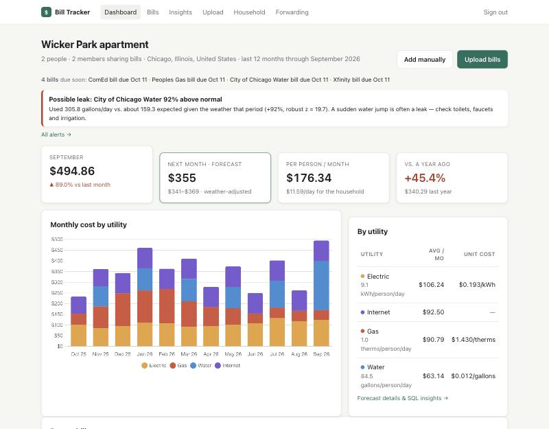
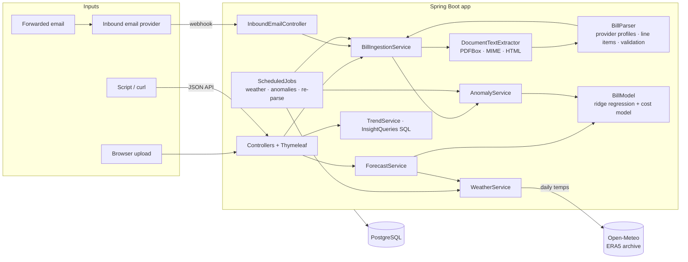
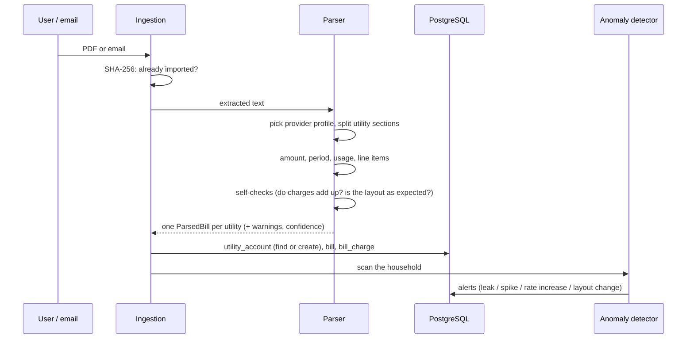
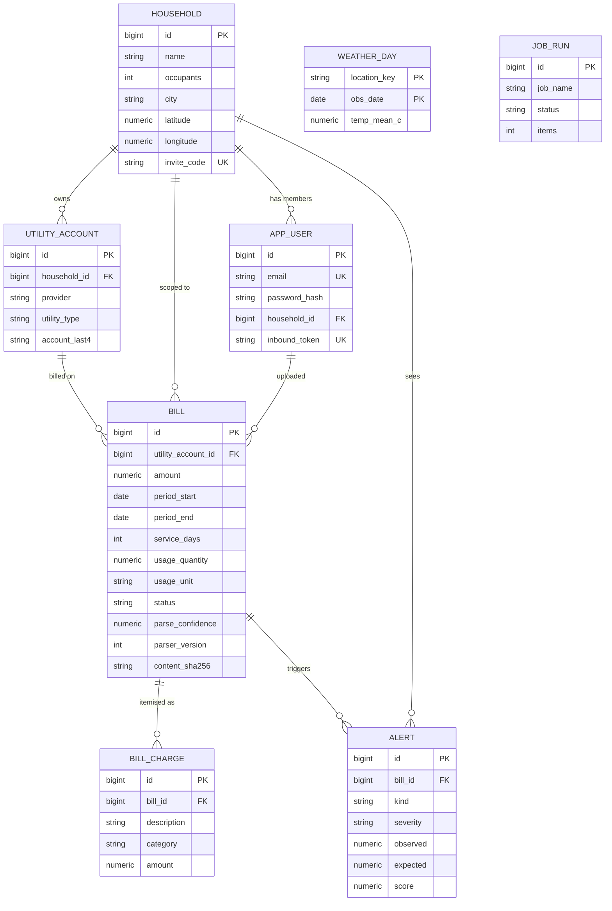

# Bill Tracker

Upload utility bills or forward the emails your utilities send. Bill Tracker reads each bill, stores it in
PostgreSQL, and shows where a household's money goes. It forecasts next month's bills from past usage and local
weather, flags anomalies such as a likely water leak, and splits costs between roommates.



**Stack:** Java 21 · Spring Boot 4 (MVC, Security, Data JPA, scheduling) · PostgreSQL + Flyway · Thymeleaf + Chart.js ·
Apache PDFBox · Jakarta Mail · Open-Meteo weather API · JUnit 5, MockMvc, Testcontainers · Docker · GitHub Actions

## Features

| Area | What it does |
|---|---|
| **Ingestion** | Upload PDF / EML / TXT / HTML bills, or forward emails to a private address (SendGrid, Mailgun, Postmark or raw MIME webhooks). Duplicates are caught by content hash. |
| **Parsing** | Reads the amount, billing period, due date, usage and account number. Combined electric + gas statements are split into one bill per utility. Line items are extracted and categorised (supply, delivery, fees, taxes, credits). |
| **Self-checking parser** | Flags bills whose line items don't add up to the total, implausible amounts, or due dates before the period ends. If a provider's bills used to read cleanly and suddenly don't, it raises a "layout may have changed" alert. |
| **Data model** | Households → utility accounts → bills → line-item charges in PostgreSQL, with 8 SQL "insight" queries shown next to their results. |
| **Forecasting** | Next bill per utility from a weather regression on heating/cooling degree days, with an 80% range and a backtest against a naive baseline. |
| **Anomaly detection** | Robust z-scores against the household's own weather-adjusted history: possible leaks, usage spikes, rate increases. Also due-date reminders. |
| **Normalisation** | Cost per day, per person and per unit, plus usage per person per day compared with US averages. |
| **Roommates** | Invite links, shared bills, an equal split per person, and who added each bill. |
| **Background jobs** | Nightly weather sync and anomaly scan, plus re-parsing of old bills when the parser improves. Every run is logged and visible on a status page. |
| **Security** | BCrypt passwords, CSRF protection, strict Content Security Policy, data scoped to the household, constant-time webhook secret check, CSV formula escaping. |

## Architecture



**What happens to a bill:**



## Data model



The schema lives in two Flyway migrations, [`V1`](src/main/resources/db/migration/V1__init.sql) and
[`V2`](src/main/resources/db/migration/V2__households_accounts_charges_analytics.sql). V2 is a real migration:
it backfills households and utility accounts from existing bills before dropping the denormalised columns.

### Questions answered in SQL

Each query is a file in [`src/main/resources/sql/insights`](src/main/resources/sql/insights). The **Insights** page
shows each question, its result and the SQL. The queries run on both PostgreSQL and H2, and the Testcontainers test
runs every one of them against real PostgreSQL.

| Question | Techniques |
|---|---|
| Month-over-month spend by utility | CTE, `DATE_TRUNC`, `LAG() OVER (PARTITION BY …)` |
| Cost per day and per person | joins, normalising by `service_days` and occupants |
| Is my price per kWh / therm / gallon rising? | usage-weighted average by quarter |
| Where the money goes (supply vs delivery vs fees vs taxes) | `SUM(SUM(x)) OVER ()` share of total |
| This year vs. last year, by month | self-join on `(year − 1, month)` |
| Roommate split | `CROSS JOIN` members × months, `LEFT JOIN` uploads |
| Due soon | parameterised date window |
| Parser health by provider | `COUNT(*) FILTER (WHERE …)` |

```sql
-- Month-over-month spend by utility (excerpt)
SELECT month_start, utility_type, spend,
       spend - LAG(spend) OVER (PARTITION BY utility_type ORDER BY month_start) AS change_amount
FROM monthly
ORDER BY month_start DESC, spend DESC;
```

## Data science

### Forecasting next month's bill

Utilities charge in two steps, so the model does too:

1. **Usage per day, from weather.** Each bill's service period is matched with daily mean temperatures for the
   household's city ([Open-Meteo](https://open-meteo.com/) ERA5 archive). Those are converted to heating and cooling
   degree days (base 18.3 °C / 65 °F). Then
   `usage/day = a + b·HDD/day + c·CDD/day` is fitted with ridge regression
   ([`LinearModel`](src/main/java/com/billtracker/analytics/forecast/LinearModel.java), dependency-free).
2. **Cost from usage:** `$ = fixed + rate·usage` by OLS on recent bills, so fixed monthly charges aren't spread into a
   misleading per-unit price.

The next period's weather is the average of the same calendar dates over the previous three years.
[`BillModel`](src/main/java/com/billtracker/analytics/forecast/BillModel.java) falls back when the data is thinner:

| Data available | Method |
|---|---|
| ≥ 6 bills with weather | weather regression |
| a bill from the same period last year | seasonal naive (same period last year) |
| otherwise | median of recent bills |
| no usage on the bill (internet, phone) | flat recurring charge |

Bills flagged as a leak or spike are **excluded from training**, so one bad month doesn't inflate next month's
forecast. Dismissing the alert ("this was normal") puts the bill back into training.

**Evaluation.** Each forecast reports a rolling-origin backtest: each of the last six bills is predicted using only
earlier bills and the weather that actually happened, and compared with the naive guess "same cost per day as the
previous bill". On the demo household (two years of synthetic usage driven by real 2023–26 Chicago weather):

| Account | Model | Backtest MAPE | Naive MAPE |
|---|---|---|---|
| Electric (ComEd) | weather regression, R² 0.89 | 3.7% | 10.1% |
| Gas (Peoples Gas) | weather regression | 5.2% | 25.4% |
| Water | weather regression, leak bill excluded | 5.7% | 10.9% |

The demo data is generated with known coefficients, so the fits can be checked: electric is simulated as
13.5 + 0.22·HDD + 1.7·CDD kWh/day and fitted as 14.3 + 0.17·HDD + 1.56·CDD. Excluding the flagged leak bill matters.
With it in the training data, the water model's cooling coefficient came out at 18.2 gal/CDD (true value 6); without
it, the fit is 6.8.

These numbers come from synthetic demo data, so they show the method works rather than how it performs on real
households.
The tests check that the regression recovers known coefficients from noisy synthetic data
([`ForecastTest`](src/test/java/com/billtracker/analytics/ForecastTest.java)).

### Anomaly detection

For every bill, the model is fitted on **earlier bills only**, so a spike can't hide itself by pulling the baseline
up. It predicts that period's usage per day, and the gap is scored as a robust z-score:

```
z = (actual − expected) / (1.4826 × MAD of past residuals)
```

The detector uses median and MAD rather than mean and standard deviation, so one past spike doesn't mask the next.
A bill is flagged when z ≥ 3.5 **and** usage is at least 25% above expected, so harmless statistical wobbles don't
raise alarms. A water spike is labelled a **possible leak**. A price-per-unit jump of 20% or more with normal usage is
reported as a **rate increase**.

Without weather, seasonal swings would look like anomalies: a Chicago gas bill can be 5× higher in January. So
without a city set, each bill is compared with the same period last year. With neither weather nor a year of
history, the detector doesn't flag spikes on heating/cooling utilities. Tests cover both the leak case and the "no
false alarms on seasonal swings" case
([`AnomalyDetectionTest`](src/test/java/com/billtracker/analytics/AnomalyDetectionTest.java)).

### Normalisation

Bills cover different numbers of days (water is often billed every two months), and households differ in size. The
dashboard and the SQL report cost per day, per person and per unit, plus usage per person per day. That figure is
compared with US averages: about 12 kWh of electricity per person per day (EIA RECS) and about 82 gallons of water
(EPA WaterSense).

## Parsing different bill formats

[`BillParser`](src/main/java/com/billtracker/parsing/BillParser.java) uses labelled-value heuristics ("Total Current
Charges", "Billing Period", "Due Date"…) rather than one template per provider, so it copes with providers it has
never seen. It prefers *current charges* over *amount due*, because amount due can include last month's unpaid
balance, which would be counted twice in a trend.

[`ProviderProfile`](src/main/java/com/billtracker/parsing/ProviderProfile.java) adds knowledge only where a format
needs it: section headers for splitting combined PG&E and Con Edison statements, and "anchor" labels each
provider's bills have always had. When an anchor disappears, or a provider whose bills read cleanly produces an
incomplete one, the bill goes to review and a `PARSER_FORMAT_CHANGE` alert is raised instead of bad numbers flowing
into the trends. When the parser improves (`BillParser.VERSION`), a weekly job re-reads stored bills that needed
review.

Tested against sample PG&E (single and combined), Con Edison, SoCalGas and municipal water bills in text, HTML and
**multi-column, multi-page PDFs** ([`RealisticPdfTest`](src/test/java/com/billtracker/parsing/RealisticPdfTest.java)).
Sample PDFs to try are in [`samples/`](samples).

## Engineering

- **Tests (93):** parser and PDF extraction; MIME email reading; regression, forecast and anomaly maths on
  synthetic data with known answers; MockMvc tests for authentication, CSRF, household isolation, invites and
  merging, every webhook format, the JSON API and all 8 SQL insights. A Testcontainers test runs the migrations and
  the SQL on real PostgreSQL. It's skipped without Docker and runs in CI.
- **Scheduled jobs**
  ([`ScheduledJobs`](src/main/java/com/billtracker/jobs/ScheduledJobs.java)): weather sync (03:00), anomaly scan and
  due-date reminders (03:30), re-parse of stale bills (Sundays). They also run once at startup to catch up.
  [`JobRunner`](src/main/java/com/billtracker/jobs/JobRunner.java) isolates failures per household and records
  each run in `job_run`, shown at `/system`. On a multi-instance deployment, add ShedLock so each job runs once.
- **Failure handling:** weather calls time out and retry with exponential backoff. If the weather service stays
  down, the models fall back to weather-free methods and the job run is marked `PARTIAL` or `FAILED`. One failing
  SQL insight doesn't break the page. Scanned PDFs without a text layer are reported for manual entry.
- **Security:** see the Features table. All bill, alert and account lookups are scoped to the caller's household.
  Another household's ids return 404, so ids can't be probed.

```
src/main/java/com/billtracker
├── user/        accounts, registration (optionally via invite)
├── household/   households, invites, joining / merging / leaving
├── bill/        Bill, UtilityAccount, BillCharge, CRUD
├── parsing/     text extraction, BillParser, provider profiles, charge extraction, validation
├── ingest/      upload + email ingestion, inbound webhook, layout-change detection
├── analytics/
│   ├── weather/   Open-Meteo client, degree days, seasonal normals
│   ├── forecast/  LinearModel, BillModel, ForecastService (+ backtests)
│   └── anomaly/   AnomalyService, alerts
├── trends/      monthly trends + normalisation
├── insights/    SQL insight queries
├── jobs/        scheduled jobs + run log
├── web/         page controllers, JSON API
└── config/      security, current-user resolver, demo data
```

## Running locally

Requires JDK 21 or later. No database install is needed:

```bash
./mvnw spring-boot:run -Dspring-boot.run.profiles=local
```

Open http://localhost:8080. The `local` profile uses an embedded H2 database (PostgreSQL mode). It seeds a demo
household: two roommates in Chicago with two years of bills driven by real Chicago weather and a simulated water
leak in the latest bill. Sign in as `demo@example.com` or `sam@example.com`; the password is in
[`DemoDataLoader`](src/main/java/com/billtracker/config/DemoDataLoader.java). If Open-Meteo can't be reached, the
demo uses synthetic weather.

With PostgreSQL via Docker:

```bash
docker compose up --build
```

## Tests

```bash
./mvnw verify
```

## JSON API

Authenticate with your session cookie or with HTTP Basic auth.

| Method | Path | |
|---|---|---|
| GET | `/api/bills` | The household's bills, newest first |
| GET | `/api/bills/{id}` | One bill |
| POST | `/api/bills/upload` | Multipart `file`; returns the parsed bill(s) |
| GET | `/api/trends?months=12` | Monthly series, normalised summary, per-utility breakdown |
| GET | `/api/forecast` | Next-bill forecast per account, with backtest errors |
| GET | `/api/alerts` | Open alerts |

```bash
curl -u you@example.com:password -F file=@samples/pge-combined.pdf http://localhost:8080/api/bills/upload
```

## Email forwarding setup

1. Pick an inbound email provider (SendGrid Inbound Parse, Mailgun Routes or Postmark Inbound). Point an MX record
   for a subdomain such as `in.yourdomain.com` at it.
2. Route that mail to `https://<your-app>/api/inbound/email?secret=<INBOUND_EMAIL_SECRET>`, or send the secret in an
   `X-Inbound-Secret` header.
3. Set `INBOUND_EMAIL_DOMAIN=in.yourdomain.com`. Each user's address is on the **Forwarding** page.

## Deploying

The app is a single Docker image.

**Public demo (Render):** push to GitHub, then choose **New → Blueprint** in Render. [`render.yaml`](render.yaml)
creates a free web service running the `demo` profile: an in-memory database seeded with the demo household, with a
**Try the demo** button on the sign-in page. Data resets whenever the service restarts, and the free plan sleeps
after 15 minutes idle, so the first request after a pause takes about a minute.

**With PostgreSQL** (Render, Fly.io, Railway, a VPS): build the `Dockerfile` and set:

| Variable | Example |
|---|---|
| `DATABASE_URL` | `jdbc:postgresql://host:5432/billtracker`, or `DB_HOST`, `DB_PORT`, `DB_NAME` |
| `DATABASE_USERNAME` / `DATABASE_PASSWORD` | |
| `INBOUND_EMAIL_DOMAIN` | `in.yourdomain.com` |
| `INBOUND_EMAIL_SECRET` | a long random string |
| `JOBS_ENABLED` | `true` (set `false` on all but one instance if you scale out) |

Health check: `/actuator/health`.

## Limitations and next steps

- Scanned PDFs without a text layer aren't read. OCR with Tesseract would be next.
- Forecasts use seasonal-normal weather; using the 16-day weather forecast for the start of the period would
  tighten them.
- Costs are split equally; weighted splits (e.g. by room size) would be a small extension of the roommate query.
- Original files aren't stored, only the extracted text. Object storage would allow full re-processing.
